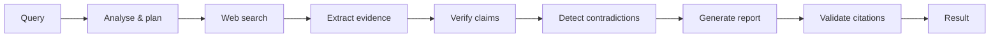

# Atharava Pawar

### AI Engineer Intern Candidate · RAG · Multi-Agent Systems · Generative AI

*I build AI systems that show their evidence, not just their answers.*

📍 Pune, Maharashtra, India · Open to relocation &nbsp;|&nbsp; 🎓 B.E. Artificial Intelligence & Data Science

---

## 👋 About

I'm an AI & Data Science engineering student focused on **LLM applications**: retrieval, agent workflows, and full-stack systems that put models behind real APIs and interfaces.

I care about the part after the demo works: grounding outputs in sources, validating them, persisting state, and making the system observable. My projects are built around that idea.

**Status:** Looking for **AI Engineer Intern** opportunities (GenAI, RAG, agentic systems, applied ML).

---

## 🚀 Featured Projects

### 🔬 ResearchPilot: Autonomous Multi-Agent Research Engine

> **Problem:** Single-prompt LLMs hallucinate facts, fabricate citations and give shallow answers.
> **Approach:** Replace one prompt with a **LangGraph pipeline of specialised agents**, where every claim must be backed by evidence and every citation validated before the user sees it.

**How it works**

1. The Next.js frontend submits a query to a **FastAPI** backend, which immediately creates a background research job and returns a research ID.
2. The LangGraph workflow runs asynchronously:
   question analysis → sub-question generation → research planning → web search (**Tavily**) → evidence extraction → multi-source claim verification → contradiction detection → report generation → **citation validation**.
3. **Server-Sent Events** stream each agent's progress to the UI in real time.
4. **PostgreSQL** persists every stage: sources, evidence, claims, reports, citations and execution logs.

**Stack:** `Python` `LangGraph` `FastAPI` `Next.js` `PostgreSQL` `Tavily` `Server-Sent Events`

🔗 **Repo:** [ResearchPilot Link](https://github.com/Atharava06/researchpilot)

---

### 📚 Production-Oriented RAG System for a 991-Page AI Engineering Book *(in progress)*

> Question answering over a long technical book, with **page-level citations**.

- **Ingestion:** PDF text extracted and cleaned with **PyMuPDF**, split into meaningful chunks.
- **Indexing:** **BGE** embeddings stored in **Qdrant**.
- **Retrieval:** **hybrid search** (vector + BM25) followed by **reranking**.
- **Generation:** an LLM (e.g. Gemini) answers from the retrieved context and cites page numbers.
- **Serving:** **FastAPI** backend, **Next.js** frontend, modular design intended to scale.

**Stack:** `PyMuPDF` `BGE` `Qdrant` `BM25` `Reranking` `Gemini` `FastAPI` `Next.js`

🔗 **Repo:** `Working On It`

---

### 🧊 Prompt → 3D Model Generation

> A full-stack generative AI app that turns a text prompt into an interactive 3D (GLB) model.

- The **FastAPI** backend creates a background job per prompt.
- **Stable Diffusion XL** generates a 2D image, then **Tencent Hunyuan3D-2.1** converts it into a 3D model.
- The **React** frontend polls job status and shows the result in a **Three.js** viewer.
- **Supabase** handles users and job management; **Cloudflare R2** stores generated files.

**What I learned:** GPU inference pipelines, asynchronous APIs, cloud object storage and integrating multiple generative models in one application.

**Stack:** `React` `FastAPI` `Stable Diffusion XL` `Hunyuan3D-2.1` `Three.js` `Supabase` `Cloudflare R2`

🔗 **Repo:** [PT3D Link](https://github.com/Atharava06/Prompt-To-3D-Model-Generations)

---

## 🧰 Tech Stack

| Area | Tools |
|---|---|
| **Languages** | Python, SQL |
| **LLM & GenAI** | LLMs, Hugging Face, LangChain, LangGraph, RAG, Stable Diffusion XL |
| **Retrieval** | Qdrant, vector embeddings (BGE), BM25, hybrid search, reranking |
| **ML / DL** | Scikit-learn, Pandas, NumPy, PyTorch, TensorFlow, OpenCV |
| **Backend** | FastAPI, Flask, PostgreSQL, MySQL, Supabase, async background jobs, SSE |
| **Frontend** | Next.js, React, Three.js |
| **Tools** | Docker, Git & GitHub, Cloudflare R2 |
| **Currently learning** | AWS, CI/CD, MLOps and model deployment |

---

## 🧭 Engineering Principles

- **Evidence over fluency:** outputs should trace back to sources, with verification and citation checks.
- **Persist and observe:** store intermediate stages and logs so behaviour can be inspected and debugged.
- **Async by default for slow work:** long-running AI jobs run in the background, with progress shown to the user.
- **Transparency:** show citations and progress instead of hiding the pipeline.

---

## 🌱 Currently Exploring

Agentic workflows and multi-agent coordination · retrieval quality (hybrid search, reranking) · MLOps and deployment · cloud infrastructure

---

## 🤝 Let's Connect

I'm looking for an AI Engineer internship where I can contribute to LLM, RAG or agent-based products and learn from an experienced team.

📧 [atharavapawar06@gmail.com](mailto:atharavapawar06@gmail.com) · 💼 [LinkedIn](https://www.linkedin.com/in/atharava-pawar-6797b0259) · 💼 [X](https://x.com/Atharava00)
